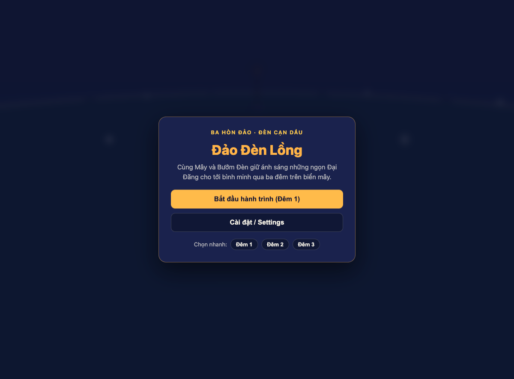
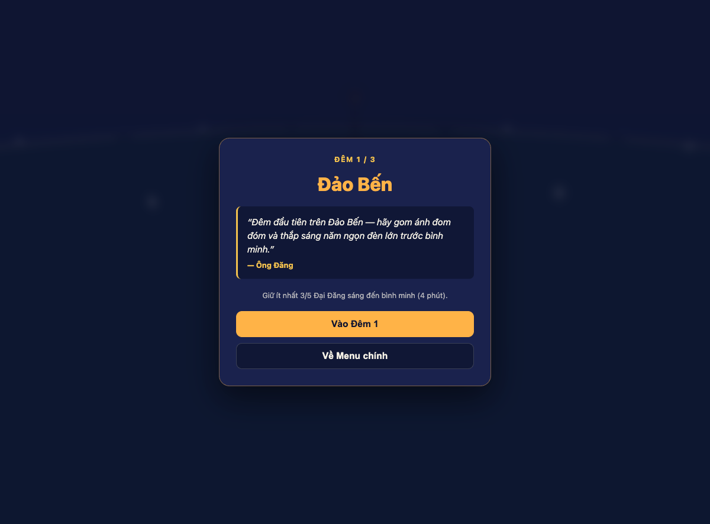
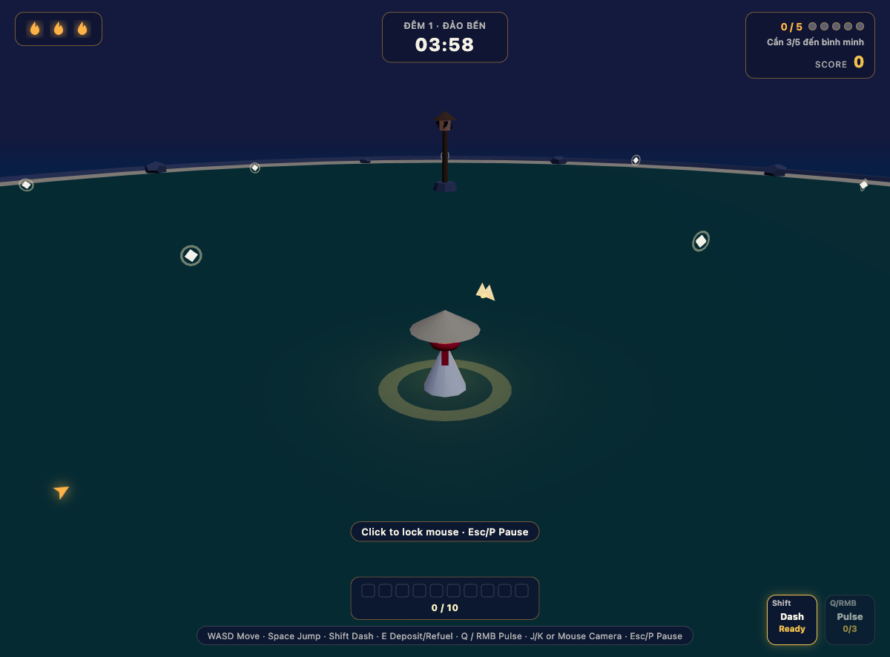

# Đảo Đèn Lồng (Lantern Island) — v1.0.0

*(video demo < 5 phút: sẽ bổ sung tại `docs/demo/demo.mp4` hoặc Release `v1.0.0`)*

Game 3D góc nhìn thứ ba xây dựng bằng **Three.js + TypeScript** (mô phỏng tất định 60 ticks/s, tuân thủ **Test Contract v1.3**). Người chơi vào vai **Mây**, thu thập đom đóm, thắp và tiếp dầu cho các Đèn Lồng Lớn, né **Bóng Mực** và **Gió Lạc** để giữ đảo sáng tới bình minh qua 3 Đêm (**Đảo Bến**, **Đảo Cầu**, **Đảo Chuông**).

| Màn hình chính | Giới thiệu | Đêm 1 — Đảo Bến |
|---|---|---|
|  |  |  |

---

## Yêu cầu hệ thống

- **Node.js >= 20** (kèm `npm`).
- **Trình duyệt để chơi:** bất kỳ trình duyệt hiện đại nào hỗ trợ WebGL và WebAudio (Chrome, Firefox, Safari, Edge).
- **Trình duyệt để chạy Benchmark:** **Google Chrome** hoặc **Chromium** cài sẵn trên máy.

---

## Cài đặt & Chạy nhanh (tối đa 3 lệnh)

```bash
npm install && npm run build
node scripts/play.mjs
npm run verify   # (tùy chọn) kiểm tra typecheck, unit test và headless
```

- `node scripts/play.mjs` *(hoặc `npm start`)*: khởi chạy máy chủ cục bộ phục vụ `dist/` trên cổng trống và tự mở trình duyệt mặc định.
- Môi trường phát triển có hot-reload: `npm run dev`.

---

## Điều khiển & Đổi phím (Key Rebinding)

| Hành động | Phím / Chuột mặc định |
|---|---|
| Di chuyển (4 hướng) | `W` `A` `S` `D` hoặc phím mũi tên (`↑` `↓` `←` `→`) |
| Nhảy | `Space` |
| Lướt (Dash) | `Shift` |
| Tương tác / Nạp đom đóm / Tiếp dầu | `E` |
| Tỏa Sáng (Pulse) | `Q` hoặc **Chuột phải** |
| Xoay camera | Di chuột (**click chuột trái** để khóa con trỏ) hoặc phím `J` / `K` |
| Tạm dừng (Pause) | `Esc` hoặc `P` |

- **Đổi phím (Key Rebinding):** Trong **Cài đặt** (Menu chính hoặc Pause), người chơi có thể gán lại phím cho mọi hành động (4 hướng di chuyển, nhảy, lướt, tương tác, Tỏa Sáng, tạm dừng). Hệ thống tự phát hiện và cảnh báo trùng phím, có nút **Khôi phục mặc định (Restore defaults)** và lưu cấu hình qua các lần khởi động lại.

---

## Trợ năng (Accessibility)

- **Đổi phím toàn diện:** Gán lại tất cả phím hành động kèm cảnh báo xung đột, khôi phục mặc định và lưu bền vững.
- **Tín hiệu thị giác & phụ đề:** Hiển thị thông báo/chỉ báo khi **Bóng Mực xuất hiện** (kèm mũi tên ở rìa màn hình chỉ hướng), **Gió Lạc sắp thổi**, **10 giây cuối**, và **đèn có `fuel < 30`** (đèn và thanh dầu nhấp nháy `1 Hz`).
- **Giảm chuyển động (Reduced motion):** Tắt rung camera và chớp màn hình (lưu bền vững).
- **Bảng màu dễ phân biệt (Color-blind mode):** Đổi viền/mắt Bóng Mực `#7A3CFF -> #00B3FF`, cảnh báo `#FF5A5F -> #FFFFFF` kèm biểu tượng cảnh báo; đèn tắt bị ép lùn 20% với giấy rách để phân biệt không cần màu.
- **Cỡ chữ dễ đọc:** Cỡ chữ UI tối thiểu `18 px` ở độ phân giải `1280×720`, hỗ trợ tùy chọn **Chữ lớn (`×1.25`)**.

---

## Bảng xếp hạng cục bộ (Local Leaderboard)

- Sau khi thắng Đêm 3 (màn hình Bình minh) hoặc thua ở bất kỳ Đêm nào, người chơi có thể nhập tên (**3–12 ký tự** `[A-Za-z0-9_]`, hỗ trợ thêm chữ cái tiếng Việt) để lưu điểm (`score` là tổng điểm các Đêm thắng, `nights_won` `0–3`, `achieved_at` chuẩn ISO 8601 kèm múi giờ, `seed`).
- Lưu **top 10** sắp xếp theo `score` giảm dần (hòa ưu tiên `achieved_at` sớm hơn), xem trực tiếp từ **Menu chính**.
- **Lưu trữ:** Ghi nguyên tử (atomic write) tại `data/leaderboard.json` (gitignored) qua API `/api/leaderboard` của `scripts/play.mjs`; nếu chạy trên host tĩnh không có API, game tự động chuyển sang `localStorage` và hiển thị rõ nguồn lưu trữ.
- **Xuất bảng xếp hạng (CLI):**

```bash
node scripts/play.mjs --export-leaderboard out.json
```

Lệnh xuất `{"entries":[...]}` đúng thứ tự vào `out.json` và thoát mã `0` mà không khởi chạy máy chủ.

---

## Kiểm thử, Headless, Benchmark & Soak Test

### 1. Kiểm thử tự động
```bash
npm run typecheck
npm test
npm run verify
```
`npm run verify` chạy đầy đủ `tsc --noEmit`, Vitest (`tests/**`) và kiểm chứng headless (`scripts/verify.sh`).

### 2. Chế độ Headless (Contract v1.3)
Mô phỏng chạy độc lập không cần trình duyệt qua `src/headless/cli.ts`, khai báo trong [game.contract.json](game.contract.json) (`contract_version: "1.3"`):

```bash
npx tsx src/headless/cli.ts --seed 1 --night 1 --ticks 600 --snapshot-every 10 --out docs/proof/sample.jsonl
```
Cờ tùy chọn: `--scenario <file.json>`, `--inputs <file.json>`, `--snapshot-every <N>` (hoặc `npm run headless -- ...`). Lỗi định dạng hoặc `tick` không tăng nghiêm ngặt thoát mã `2`.

### 3. Benchmark (Chuẩn Contract v1.3)
```bash
node scripts/play.mjs --bench --seed 42 --duration 30 --out bench.json   # (hoặc npm run bench -- ...)
```
- **Cảnh chuẩn:** Cửa sổ `1280×720` (không toàn màn hình), Đêm 1 với đầy đủ ánh sáng/hiệu ứng như khi chơi thật; sinh đúng `200` Bóng Mực (`wander`, phân bố đều theo `seed 42`), `100` đom đóm, `L1`–`L3` đang sáng (`fuel = 100`); tắt sinh thêm, sát thương, nhặt đom đóm, hao dầu, điều kiện kết thúc Đêm và **tắt toàn bộ sáng tạo phụ (Bướm Đèn)**. Mây đứng tại `(0, 0, 0)` không có input; camera bay vòng tròn tâm `(0, 0, 0)`, bán kính `30 m`, cao `Y = 15 m`, luôn nhìn về `(0, 0, 0)`, bắt đầu từ `(30, 15, 0)` ngược chiều kim đồng hồ `15 s/vòng`. `3 s` đầu warm-up (không đo), sau đó đo đúng `--duration` giây và thoát mã `0`.
- **Trường kết quả trong `bench.json`:** `contract_version` (`"1.3"`), `avg_fps`, `p1_low_fps`, `frame_ms_p95`, `frames`, `load_ms`, `peak_mem_mb`, `vsync_off`, `renderer`, `os`.
- **Định nghĩa chỉ số:**
  - `frames = N`: số khung hình trong cửa sổ đo.
  - `avg_fps = 1000 * N / sum(dt_i)` (với `dt_i` là khoảng thời gian từng khung hình tính bằng `ms` từ `performance.now()`).
  - `p1_low_fps`: với `k = max(1, ceil(0.01 * N))`, lấy `k` giá trị `dt_i` lớn nhất, `p1_low_fps = 1000 / mean(k giá trị đó)`.
  - `frame_ms_p95`: phân vị thứ 95 của `dt_i` (`ms`).
  - `load_ms`: thời gian từ lúc khởi chạy tiến trình launcher tới khung hình đầu tiên của cảnh bench (`POST /api/bench/first-frame`).
  - `peak_mem_mb`: tổng RSS lớn nhất (MB) của toàn bộ cây tiến trình trình duyệt được spawn, lấy mẫu bằng `ps` mỗi `250 ms` trong cửa sổ đo (`null` kèm giải thích nếu môi trường không đo được).
- **Xử lý VSync:** Launcher khởi chạy Chrome/Chromium với cờ `--disable-gpu-vsync --disable-frame-rate-limit` (khi đó `vsync_off: true`). Nếu máy không cài Chrome/Chromium, launcher thoát khác `0` kèm hướng dẫn cài đặt trên `stderr`.
- **Ngưỡng đạt:** `avg_fps >= 60`, `p1_low_fps >= 30`, `load_ms <= 10000`.

### 4. Soak Test (Kiểm tra rò rỉ bộ nhớ & ổn định)
```bash
npx tsx src/headless/soak.ts --seed 7 --nights 10 --out soak.json   # (hoặc npm run soak -- ...)
```
- Chạy headless `10` Đêm liên tiếp trong **một tiến trình** (xoay vòng Đêm `1 -> 2 -> 3`, Đêm `i` dùng seed `7 + i`, input ngẫu nhiên theo seed: đổi hướng mỗi `30` tick; mỗi tick xác suất `5%` nhảy, `3%` lướt, `2%` Tỏa Sáng, `10%` tương tác).
- Xuất `soak.json` gồm `nights`, `crashes`, `results`, `mem_start_mb` (RSS sau khi nạp Đêm 1), `mem_end_mb` (RSS sau khi reset Đêm cuối), `duration_s`.
- **Ngưỡng đạt:** `crashes === 0` và `mem_end_mb <= 1.2 * mem_start_mb`.

---

## Đóng gói Phát hành (Release Artifact)

Gói phát hành web tĩnh cho GitHub Release `v1.0.0`:

```bash
bash scripts/package-release.sh
```

Tạo tệp `release/dao-den-long-web-v1.0.0.zip` chứa `dist/`, `scripts/play.mjs` và `RUN.txt`. Người dùng cuối chỉ cần giải nén và chạy `node scripts/play.mjs` (yêu cầu Node `>= 20`).

---

## Luật thắng, Tính điểm & Giả định (v1.2 / v1.3)

- **Thắng Đêm (`dawn_survived`):** Sống sót đến bình minh với số đèn sáng `>= ceil(0.6 * n)` — Đêm 1: `3/5` (`240 s`), Đêm 2: `4/6` (`270 s`), Đêm 3: `5/7` (`300 s`). Thắp hết đèn **không** thắng sớm; `no_flames` luôn ưu tiên thua trước.
- **Nhiên liệu & Sức chứa:** Đèn sáng bắt đầu `fuel = 100` (tính nội bộ theo đơn vị nguyên `1/60`), tự hao `1/s`, tiếp dầu `+10`/đom đóm; vùng an toàn `6 m` cần `fuel >= 30`; đèn tắt (`ever_lit`) thắp lại tốn `5` đom đóm (mới: `10`). Sức chứa `min(20, 10 + 2 * successful_lights)` mỗi Đêm.
- **Điểm:** `+5`/đom đóm nạp; `+100` thắp lần đầu / `+40` thắp lại; Pulse trúng Bóng Mực `+5` (`+15` tổng nếu đang `drain`); thưởng bình minh (khi thắng) `+50 + floor(fuel)` mỗi đèn sáng và `+50` mỗi ngọn lửa còn lại.
- **Giả định chính:** Điểm xuất phát Đêm 3 là `(0, 0, -12)` (Tầng 0, nhìn `+Z`) vì `(0, 0, 0)` nằm trong Tháp Chuông; tọa độ cực `x = r*cos(θ), z = r*sin(θ)` từ `+X` ngược chiều kim đồng hồ; `night_start` phát ở `sim_tick = 1`. Chi tiết xem [docs/notes/assumptions-phase2.md](docs/notes/assumptions-phase2.md) và [docs/notes/spec-phase3.md](docs/notes/spec-phase3.md).

---

## Sáng tạo của tôi

- **Bướm Đèn (Lantern Moth Companion)** — [src/renderer/mothCompanion.ts](src/renderer/mothCompanion.ts): chú bướm giấy phát sáng bay cạnh Mây, vỗ cánh nhanh hơn và dẫn hướng về đèn cần thắp khi Mây mang đủ đom đóm, tóe hạt sáng khi thắp đèn / Tỏa Sáng / nhặt Bùa Gió (dùng vật liệu phát sáng, không tạo thêm `PointLight`).
- **Tách biệt hoàn toàn khỏi headless, benchmark và soak:** Chỉ đọc `SimSnapshot` / `SimEvent[]` ở tầng renderer; không có import từ `src/renderer` trong `src/sim` hay `src/headless`, và tự động tắt trong chế độ benchmark (`?bench=1`) để không ảnh hưởng kết quả đo hiệu năng hay tính tất định.

---

## Harness & Tài liệu dự án

- **AI Harness:** [AGENTS.md](AGENTS.md), [.claude/skills/headless-proof/SKILL.md](.claude/skills/headless-proof/SKILL.md)
- **Tài liệu thiết kế & tổng kết:** [CHANGELOG.md](CHANGELOG.md), [CREDITS.md](CREDITS.md), [LICENSE](LICENSE), [ADR-0001](docs/notes/adr-0001-lantern-fuel-and-dawn-win.md), [Spec Phase 3](docs/notes/spec-phase3.md), [Spec Phase 4](docs/notes/spec-phase4.md), [Retrospective](docs/notes/retro.md), [AI Log](docs/notes/ai-log.md)
- **Bằng chứng kiểm chứng:** [docs/proof/phase-1.md](docs/proof/phase-1.md), [docs/proof/phase-2.md](docs/proof/phase-2.md), [docs/proof/phase-3.md](docs/proof/phase-3.md), [docs/proof/review-client-phase3.md](docs/proof/review-client-phase3.md)
- **Tài liệu gốc của Lab:** [GUIDE.md](GUIDE.md) · [CHECKPOINTS.md](CHECKPOINTS.md) · [SUBMISSION.md](SUBMISSION.md) · [RULES.md](RULES.md) · [RUBRIC.md](RUBRIC.md)
